

<picture>
  <source media="(prefers-color-scheme: dark)" srcset="media/banner-dark.png">
  <source media="(prefers-color-scheme: light)" srcset="media/banner-light.png">
  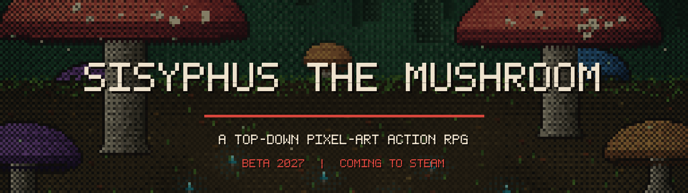
</picture>

 

**Fall in the forest, wake up in the village, go back in stronger.**

[Trailer](#-trailer) &middot; [Features](#-features) &middot; [Roadmap](#-roadmap) &middot; [Under the hood](#-under-the-hood) &middot; [Build](#-build-and-run) &middot; [Author](#-author)

  
Table of contents

  <ol>
    <li><a href="#-trailer">Trailer</a></li>
    <li><a href="#-about-the-game">About the game</a></li>
    <li><a href="#-features">Features</a></li>
    <li><a href="#-roadmap">Roadmap</a></li>
    <li><a href="#-under-the-hood">Under the hood</a></li>
    <li><a href="#-build-and-run">Build and run</a></li>
    <li><a href="#-license">License</a></li>
    <li><a href="#-author">Author</a></li>
  </ol>

## 🎬 Trailer

<!-- When the trailer is on YouTube, replace the href with its URL. Nothing else changes. -->
<a href="#-trailer">
  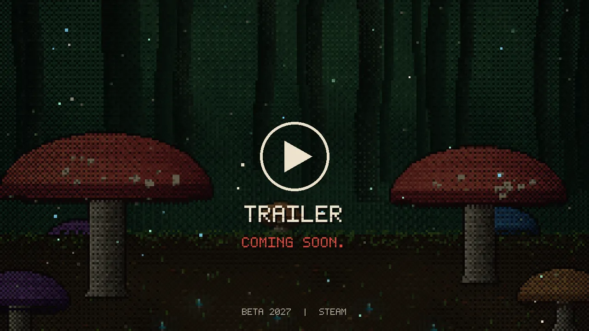
</a>

*Gameplay trailer in production. Beta release planned for 2027.*

(<a href="#readme-top">back to top</a>)

## ✨ About the game

**Sisyphus the Mushroom** is a top-down 2D action RPG in hand-made pixel art. Falling in the forest does not end the run: you wake up again, keep your progress, and head back out a little stronger.

The first chapter runs from a strange prologue, through a quiet village and its people, to the first boss, the Slime King. The story is told through visual-novel scenes, in-world documents and short conversations rather than long cutscenes.

  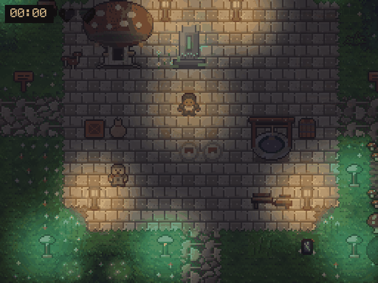
   
  The village across a full in-game day. Live rendering, no mock-ups.

(<a href="#readme-top">back to top</a>)

## 🍄 Features

| | |
|---|---|
| ⚔️ **Combat with a swap rhythm** | Short sword, heavy sword, pistol and shotgun. Switching weapons mid-fight grants a damage bonus with a cooldown, so you plan swings instead of mashing one button. |
| 🎯 **Marks and detonations** | Ranged attacks mark enemies, melee attacks detonate the marks. Relics change how both halves behave. |
| 👑 **Multi-phase bosses** | The Slime King changes tactics across three phases, each with its own music. |
| 🌗 **A living world** | A full day and night cycle with dawn and dusk, local light sources, weather-like ambience and a clock that advances when you sleep or fall. |
| 🏘️ **A village that remembers** | Residents have conversation menus, errands and reactions to what you did. A mining station, a forge, a dojo and an anchor stone you return to. |
| 🌲 **Forest to explore** | Trails, valleys, lakes and fog. A map and minimap with discovery masks, iron ore to mine and shortcuts to open. |
| 📖 **Story you read in the world** | Notes, pages and reports you can pick up and re-read. A built-in visual-novel layer for the scenes that need it. |
| 🎶 **Original soundtrack** | Dozens of tracks and effects composed with a custom synthesizer: one theme per place, per boss phase and per mood. |
| 💾 **Careful saves** | Slot saves with migration of older versions, and a resume point that is separate from the respawn point. |

  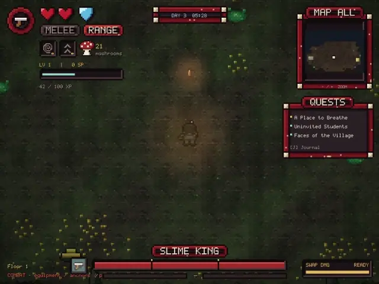
   
  The Slime King: a swap-attack hit, a poison spiral and the crystal shell phase.

### 📸 Gallery

<table>
  <tr>
    <td align="center">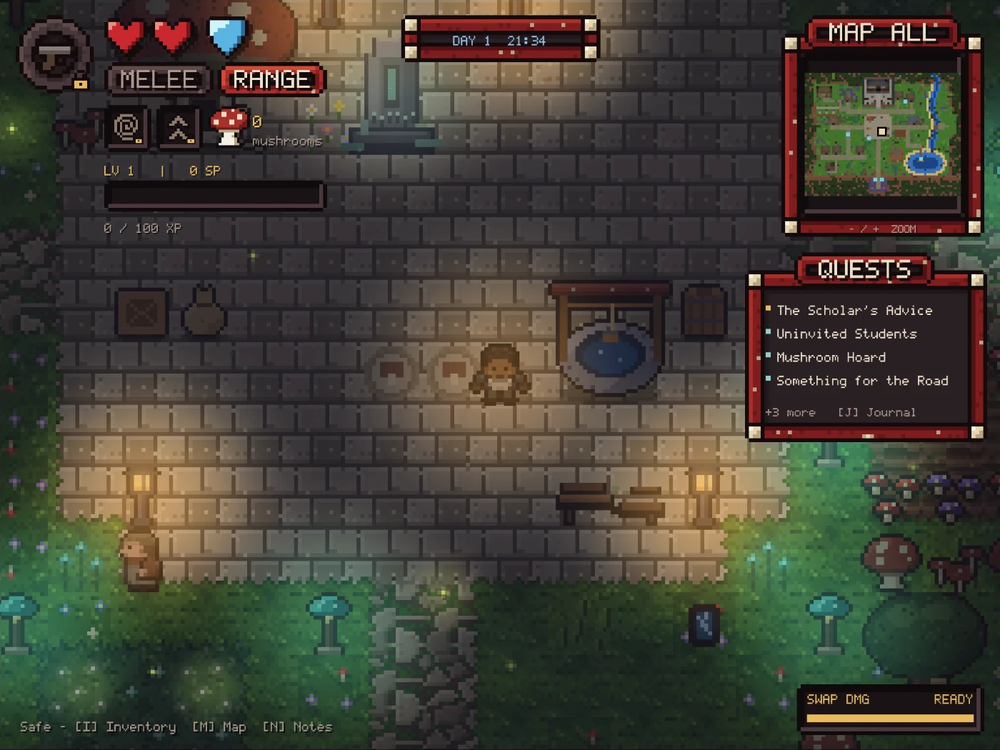 <b>The village at night</b>: lamps, dusk light and the quest tracker</td>
    <td align="center">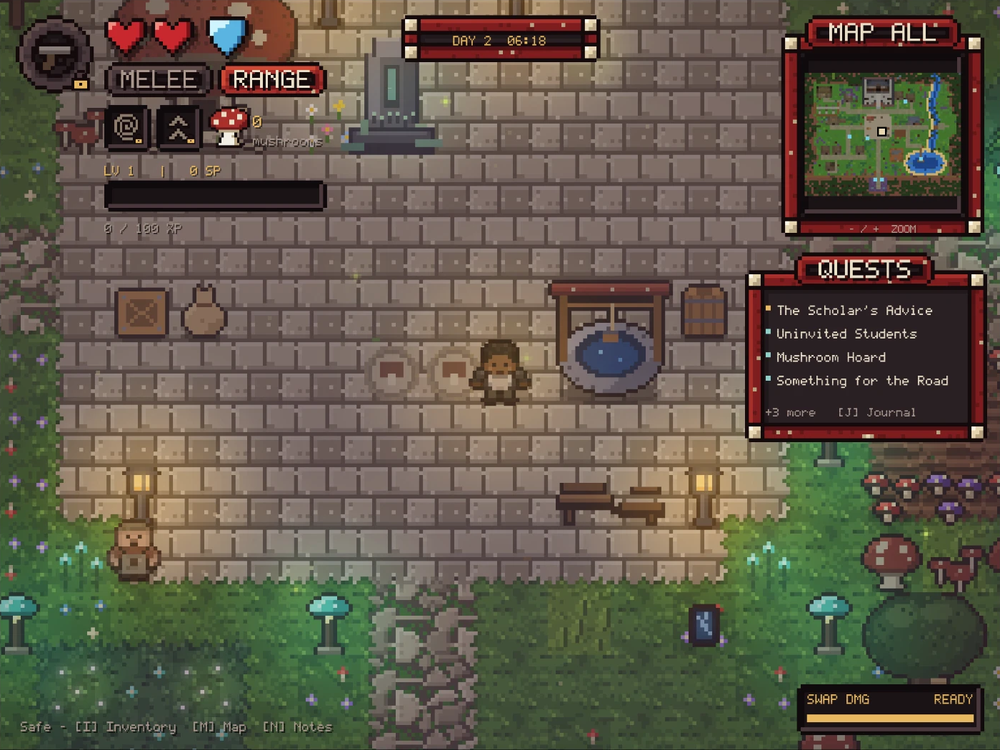 <b>Dawn in the village</b>: the same square a few hours later</td>
  </tr>
  <tr>
    <td align="center">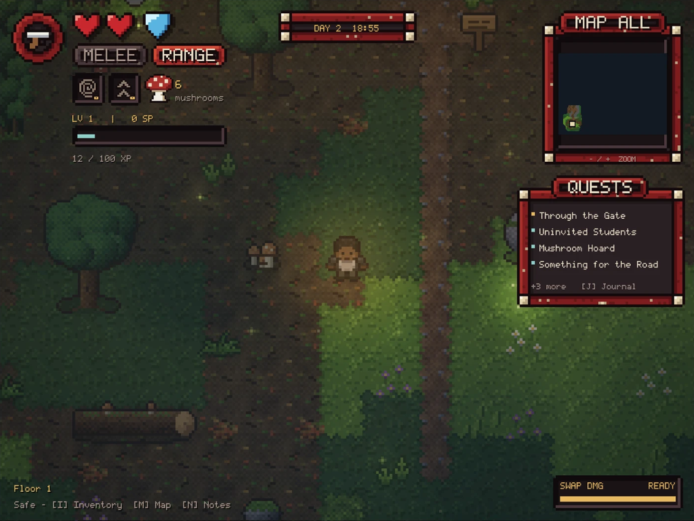 <b>The forest</b>: trails, lamplight and a minimap that fills in as you explore</td>
    <td align="center">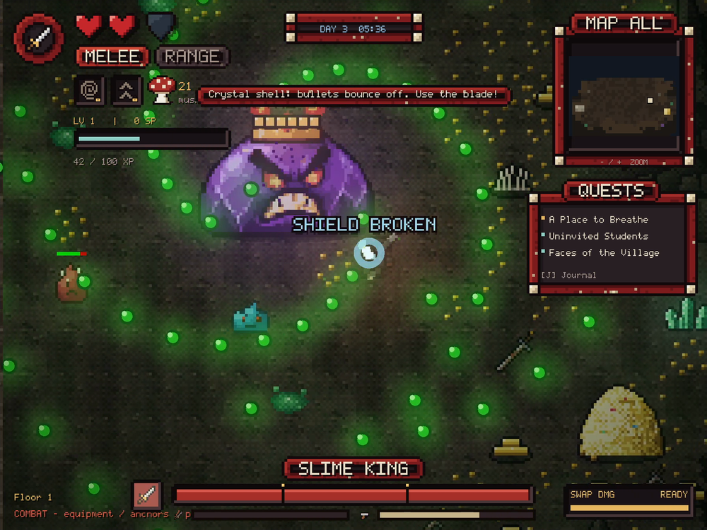 <b>The Slime King</b>: a three-phase boss fight</td>
  </tr>
  <tr>
    <td align="center">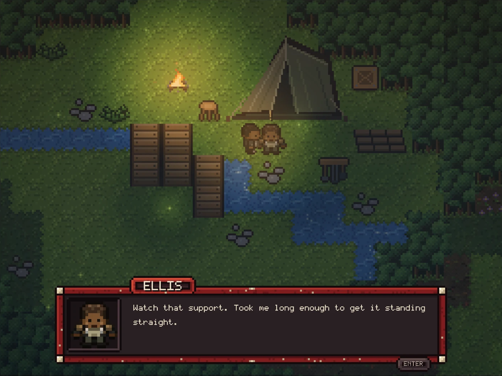 <b>Conversations</b> with the people you meet</td>
    <td align="center">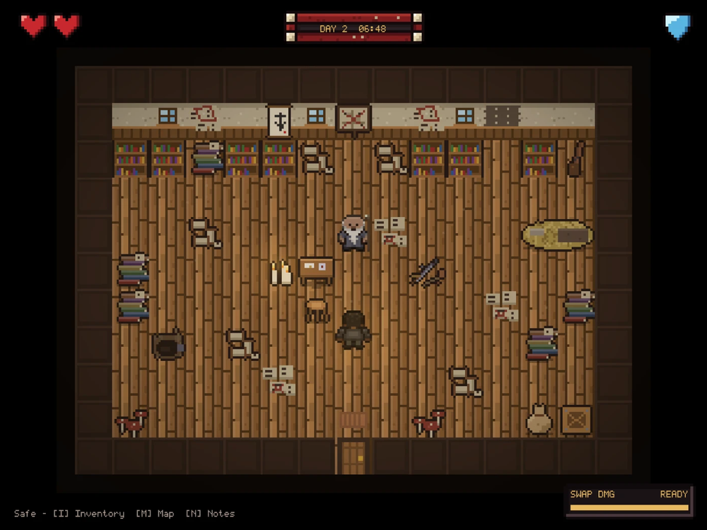 <b>Interiors</b>: the village houses can be entered</td>
  </tr>
  <tr>
    <td align="center">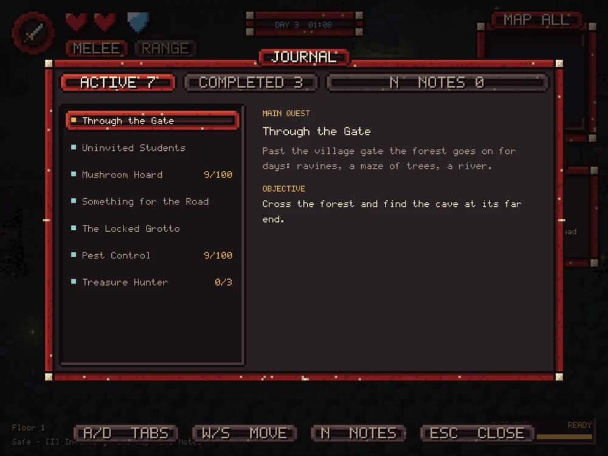 <b>The journal</b>: main quest, side quests and notes</td>
    <td align="center">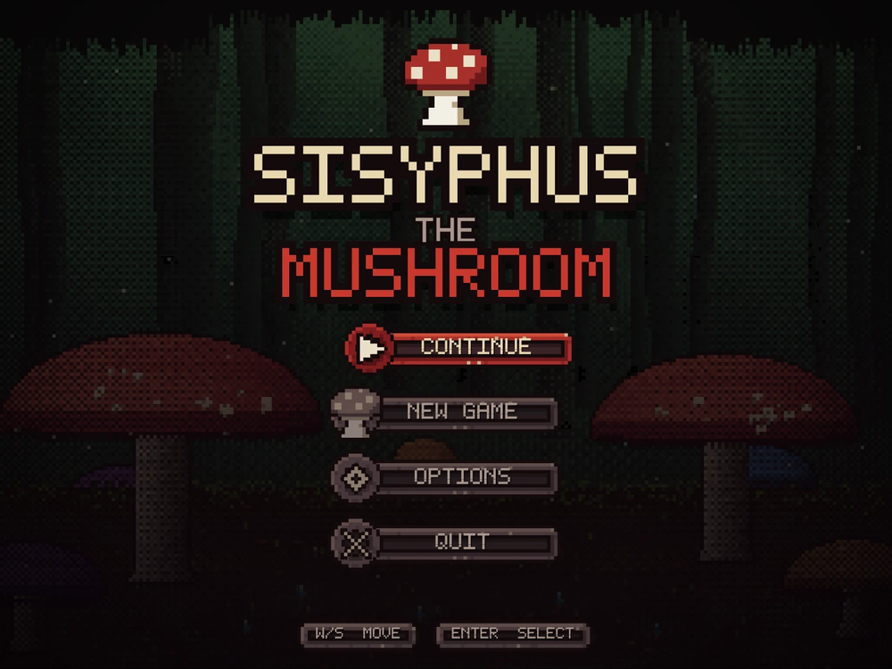 <b>The title screen</b></td>
  </tr>
</table>

> [!NOTE]
> More screenshots and clips will be added as the beta gets closer.

(<a href="#readme-top">back to top</a>)

## 🗺️ Roadmap

- [x] Prologue, training and the first encounter
- [x] Village with interiors, residents, shops and an anchor stone
- [x] First forest with trails, lakes, mining and shortcuts
- [x] Slime King boss fight with rewards
- [x] Day and night cycle, sleep, death and return loop
- [x] Original music and effects, PCM audio mixer
- [x] Authoring tools for maps, placements and story scenes
- [ ] Chapter One story rework and polish pass
- [ ] Chapters 2 to 8 and their bosses
- [ ] Closed testing
- [ ] **Public beta, 2027**
- [ ] **Steam release**

(<a href="#readme-top">back to top</a>)

## 🔧 Under the hood

This repository publishes the game's source code. The game is built **without a game engine**: windowing, the render pipeline, lighting, audio mixing, saves and tooling are written from scratch on top of Java 21, Swing and Java2D.

<b>Architecture at a glance</b>

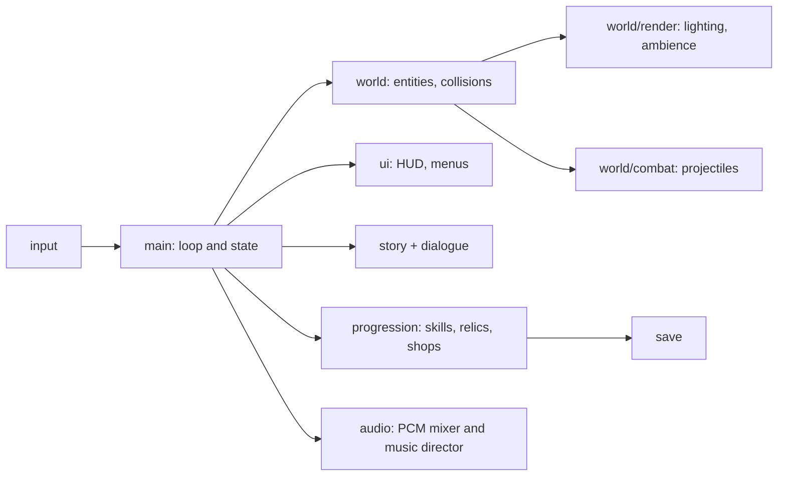

| Package | Responsibility |
|---|---|
| `main` | Game panel, loop and game state |
| `audio`, `settings`, `input` | Playback, player settings, keyboard handling |
| `ui`, `debug` | HUD, menus, window management, developer tools |
| `progression`, `save` | Skills, relics, wallet, shops, persistence |
| `entity` | Actors, animation, combat rules, weapons, enemies, NPCs |
| `world`, `world/combat`, `world/render` | World objects, collisions, projectiles, lighting |
| `level`, `tile` | Campaign structure, maps, tile data and rendering |
| `story`, `dialogue` | Story sequences, quests, conversations |

<b>Engineering highlights</b>

- A **custom PCM mixer** with its own thread, crossfades, voice limits and a cache budget, instead of per-clip playback.
- A **CPU lighting and ambience pipeline** that produces a smooth day and night cycle at whole-number pixel scales.
- **Versioned saves** with migration, rollback on failed writes and a clear split between the resume point and the respawn point.
- A **narrative state machine** for scenes, quests, conversation menus and area triggers, driven by script files.
- **Private authoring tools** for maps and story scenes, and generators for art and audio, so content is reproducible.
- A large automated test suite: JUnit tests plus chapter regression scenarios that drive the real game headlessly and check rewards, saves, audio and rendering. Continuous integration runs on Windows and Linux.

<b>By the numbers</b>

| | |
|---|---|
| Language | Java 21 |
| Public source files | 140+ |
| Public source lines | roughly 28,000 |
| Automated tests | 130+ unit tests and a set of integration scenarios |
| Engine dependencies | none |

(<a href="#readme-top">back to top</a>)

## 🚀 Build and run

> [!IMPORTANT]
> This repository contains only the source code. The artwork, music, maps and story scripts are not published, so the game cannot be built from this repository alone. Playable builds will be released through the beta and Steam.

The code expects Java 21 and the project layout described above. If you want to read the code, start with `src/main/`, then follow the packages in the table.

(<a href="#readme-top">back to top</a>)

## 📝 License

The **source code** is released under the [MIT License](LICENSE).

All game assets (graphics, music, sound effects, fonts, maps and story) and the screenshots and clips in `media/` are Copyright (c) 2026 Maciej Serafin, **all rights reserved**. They are not covered by the MIT license; see [ASSETS-LICENSE.md](ASSETS-LICENSE.md).

## 👤 Author

**Maciej Serafin**

- GitHub: [@macieserafin](https://github.com/macieserafin)

If you like the project, a ⭐ helps a lot while the Steam page is being prepared.

---

  Made with Java, pixels and too many mushrooms.

